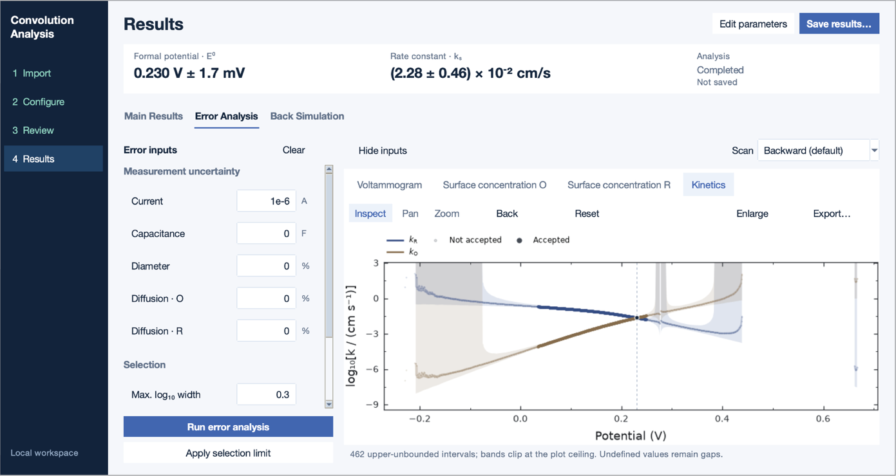

# Convolution Analysis

A desktop application for convolution analysis of cyclic-voltammetry (CV) data.
Import a CV, configure the experiment, review preprocessing, and inspect surface
concentrations, formal potential E₀, standard rate constant kₛ, and kinetic curves.
Optional error analysis and B-V/MHL back simulation are available in Results.



## Install

Download and extract the repository, or clone it, then open a terminal in its root
folder. Use Python **3.13** with **Tkinter**. The desktop application has been tested
on macOS ARM64; automated checks are configured for macOS, Windows and Linux.

On macOS or Linux:

```bash
python3 -m venv .venv
source .venv/bin/activate
python -m pip install .
```

On Windows (PowerShell):

```powershell
py -3.13 -m venv .venv
.venv\Scripts\python.exe -m pip install .
```

Installation uses the dependency versions in `requirements.txt`. Tkinter is
provided by your Python distribution. Check it with
`python -m tkinter`; a small window should open. On Linux, install your
distribution's Tkinter package if it is missing.

## Run

With the environment activated:

```bash
python -m convolution_cv
```

On Windows, you can instead run `.venv\Scripts\python.exe -m convolution_cv`.
Installation also provides the `convolution-analysis` command.
Use `python -m convolution_cv --version` to check the installed version.

## Try the included example

1. **Import:** open `examples/ferrocene/20V.csv`. The preferred columns are
   `Potential/V` and `Current/A`; other column names can be mapped on import.
2. **Configure:** click **Load preset parameters** and select
   `examples/ferrocene/20V.json` to load the experiment parameters.
3. **Review:** inspect the selected cycle and background correction. Adjust
   No smoothing / SG, potential window, or polynomial order to update the preview.
4. **Results:** run the analysis and switch between the full-size plots.
5. Optionally run **Error Analysis** or **Back Simulation**. B-V uses α; MHL uses
   λ in eV. Back simulation compares against the BG-subtracted input CV.
6. **Save Latest Results:** choose an output folder and open `Overview.html`
   inside the newly created run directory.

Each demo contains an experimental CV, its measured blank and a preset:

| Example | Folder | Scan rate |
|---|---|---:|
| Ferrocene | [ferrocene](examples/ferrocene/) | 20 V/s |
| Ferrocyanide | [ferrocyanide](examples/ferrocyanide/) | 10 V/s |
| Dioxygen | [dioxygen](examples/dioxygen/) | 50 V/s |
| Tris(2,2′-bipyridine)ruthenium | [tris_bipyridine_ruthenium](examples/tris_bipyridine_ruthenium/) | 50 V/s |
| tert-Nitrobutane | [tert_nitrobutane](examples/tert_nitrobutane/) | 10 V/s |

For detailed controls, defaults, and troubleshooting, see the
[user guide](docs/USER_GUIDE.md).

### Jupyter notebook

The [example walkthrough](examples/analysis_walkthrough.ipynb) demonstrates the Python
workflow: load a preset and measured blank, review smoothing, calculate results
and uncertainties, compare a back simulation, and save a report. Ferrocyanide is selected
by default; the notebook also supports the other four included cases.

With the environment activated, run these commands from the repository root:

```bash
python -m pip install jupyterlab
python -m jupyter lab examples/analysis_walkthrough.ipynb
```

Select the Python kernel from that environment and run the cells from top to
bottom. The final cell saves a new report under `results/notebook/`. JupyterLab is
an optional dependency for this workflow.

## Saved results

Each save creates a separate timestamped directory. Existing runs are retained.
The package contains an offline HTML overview, full-precision CSV/JSON data,
PNG/SVG/PDF figures, calculation settings, input hashes, and copies of the input
files when requested. Completed back simulations add comparison data and figures.
Open `FILE_GUIDE.md` inside the saved folder for the output definitions.

Share the whole run folder to keep figure and data links working. The save status
is recorded in `manifest.json`.

## Documentation

- [User guide](docs/USER_GUIDE.md): workflow, defaults, presets, plots and exports.
- [Calculation method](docs/DATA_ANALYSIS_METHOD.md): implemented equations,
  normalization, units and interpretation notes.
- [Back simulation](docs/BACK_SIMULATION.md): solver and comparison settings.

## Development and tests

From the repository root, install with `python -m pip install -e .`.
Run the compact smoke test using the five demo cases:

```bash
python -m unittest discover -s tests -v
```

For a machine without a display, set `MPLBACKEND=Agg` first. The desktop smoke
check requires an interactive display (or Xvfb on Linux):

```bash
python -m tests.gui_smoke --output gui-check.json
```

The smoke test covers demo loading, plots, reports, simulation and workers.
The optional desktop check loads the same five presets. Bug reports should include the software version, OS,
steps to reproduce, and a shareable minimal input where possible.

## License

The MIT license text is in [LICENSE](LICENSE).
